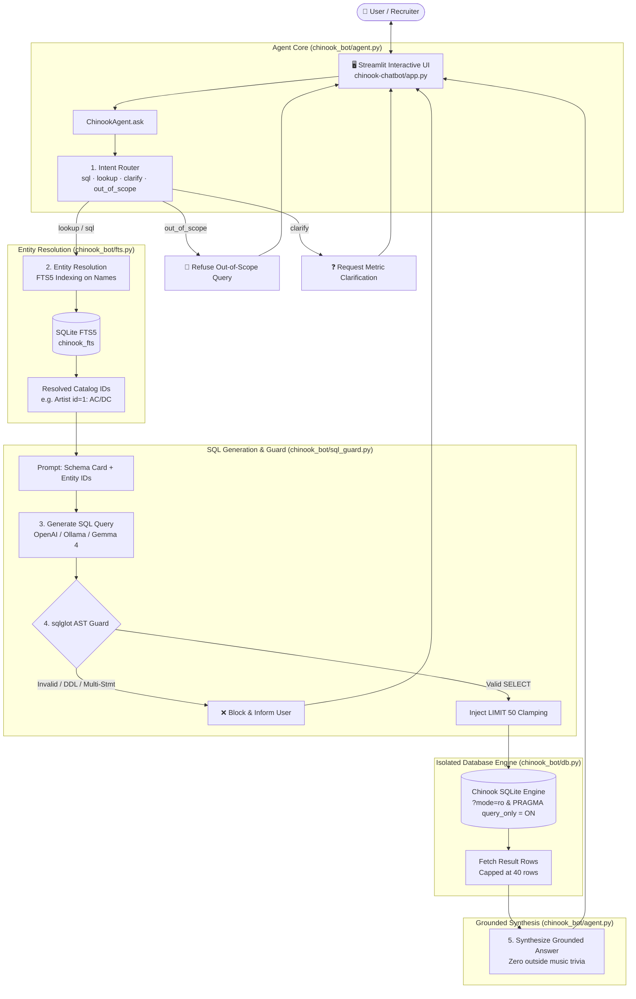

# 🎵 Chinook AI Store Assistant

> **Enterprise-Grade, Defense-in-Depth Text-to-SQL Chatbot over the Chinook SQLite Database**  
> *Architected & Built by **Supreeth Sudhakaran Menon** as an advanced technical interview challenge.*

[](https://www.python.org/)
[](https://streamlit.io/)
[](https://github.com/tobymao/sqlglot)
[](https://www.sqlite.org/fts5.html)
[](https://ollama.com/)
[](chinook-chatbot/tests/test_offline.py)

---

## 🚀 Quick Navigation
- **[🤖 Chatbot Implementation & Deep-Dive](chinook-chatbot/README.md)**
- **[🏛️ System Architecture & Mermaid Diagrams](chinook-chatbot/ARCHITECTURE.md)**
- **[⚡ Quickstart & Setup Guide](#-quickstart)**
- **[🗄️ Original Chinook Database Documentation](#-underlying-chinook-database)**

---

## 💡 About The Solution & Engineering Craft

Given only a raw database dump (`Chinook_Sqlite.sql`) and the challenge to build a conversational assistant around it, this solution rejects naive text-to-SQL wrappers (which dump prompts into an unconstrained LLM and run raw SQL against production data).

Instead, this project is engineered with **production-grade rigor**, addressing the 5 fundamental failure modes of Text-to-SQL in production:

| The Real-World Failure Mode | How Most Prototypes Fail | How This Architecture Solves It |
| :--- | :--- | :--- |
| **1. Entity Misalignment** | User queries for *"AC DC"* or *"Helena"*; SQL does `WHERE Name = 'AC DC'` and returns 0 rows. | **SQLite FTS5 Full-Text Engine**: Resolves names and fuzzy misspellings into exact primary keys (`Artist id=1`) *before* SQL generation. |
| **2. SQL Injection & Destructive DDL/DML** | LLM hallucinates `DROP`, `DELETE`, `UPDATE`, or stacked `;` queries. | **AST Validation (`sqlglot`)**: Parses the Abstract Syntax Tree, strictly rejecting non-SELECT nodes, multi-statements, and non-whitelisted tables/columns. |
| **3. Accidental Write Attacks** | Malicious or buggy SQL slips past string filters. | **Database-Level Read-Only Sandbox**: Database connections enforce URI `?mode=ro` **and** execute `PRAGMA query_only = ON`. Writes are physically impossible. |
| **4. Unbounded / Expensive Queries** | User asks for *"all tracks"*; server exhausts memory trying to render 100,000 rows. | **AST-Level Limit Clamping**: Automatically injects `LIMIT 50` into the AST while intelligently sparing single-row scalar aggregations (`COUNT(*)`, `SUM()`). |
| **5. Hallucination & Trivia Bleed** | Model answers from general pre-training memory instead of store data. | **Closed-World Grounded Synthesis**: Router segregates `out_of_scope` questions; the synthesis layer answers strictly from SQL result sets. |

---

## 🏛️ System Architecture & Workflow



---

## 🖥️ Streamlit Dashboard Walkthrough

The interface provides complete transparency into the agent's thought process and database interactions:

```
┌────────────────────────────────────────────────────────────────────────────────────────┐
│ ♪ Chinook Store Assistant                                                              │
│ Answers only from the Chinook sample database (catalog, invoices, customers, employees)│
├──────────────────────────────┬─────────────────────────────────────────────────────────┤
│ 📚 What this bot knows       │ 👤 User: Who are the top 3 customers by invoice total?  │
│                              │                                                         │
│ • Tables & Foreign Keys      │ 🤖 Assistant:                                           │
│   - Album, Artist, Customer  │ The top 3 customers by total invoice expenditure are:   │
│   - Employee, Genre, Invoice │ 1. Helena Holý ($49.62)                                 │
│   - InvoiceLine, Track, etc. │ 2. Richard Cunningham ($47.62)                          │
│                              │ 3. Luis Rojas ($46.62)                                  │
│ • Sample Questions           │                                                         │
│   - Top customers by sales   │ ▼ SQL used                                              │
│   - Tracks in Rock genre     │   ```sql                                                │
│   - AC/DC album inventory    │   SELECT c.FirstName, c.LastName, SUM(i.Total) as Spent │
│   - Support reps for clients │   FROM Customer c JOIN Invoice i ON ...                 │
│                              │   GROUP BY c.CustomerId ORDER BY Spent DESC LIMIT 3;    │
│                              │   ```                                                   │
│                              │   [Tabular Dataframe with exact row counts]             │
├──────────────────────────────┴─────────────────────────────────────────────────────────┤
│ [ Ask about Chinook artists, sales, playlists, customers...                          ] │
└────────────────────────────────────────────────────────────────────────────────────────┘
```

---

## ⚡ Quickstart

```bash
cd chinook-chatbot
python3 -m venv .venv
source .venv/bin/activate
pip install -r requirements.txt
cp .env.example .env
streamlit run app.py
```

To run the offline test suite (no API key needed):
```bash
python tests/test_offline.py
```

---

## 🗄️ Underlying Chinook Database

The underlying data model represents a digital media store, including tables for artists, albums, media tracks, invoices and customers.


### Entity Overview
- **Catalog**: `Artist`, `Album`, `Track`, `Genre`, `MediaType`
- **Playlists**: `Playlist`, `PlaylistTrack`
- **Sales & Invoicing**: `Customer`, `Invoice`, `InvoiceLine`
- **Support Staff**: `Employee`

---

## 👨‍💻 Author

**Supreeth Sudhakaran Menon**  
- **GitHub**: [@SupreethSudhakaranMenon](https://github.com/SupreethSudhakaranMenon)
- **Role**: Software & AI Engineer
