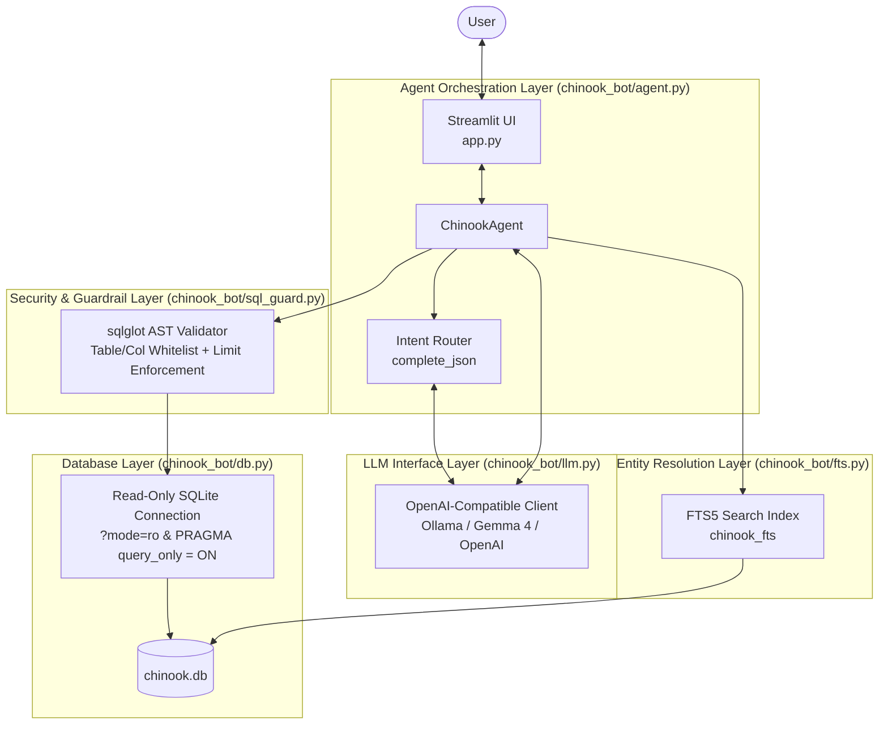
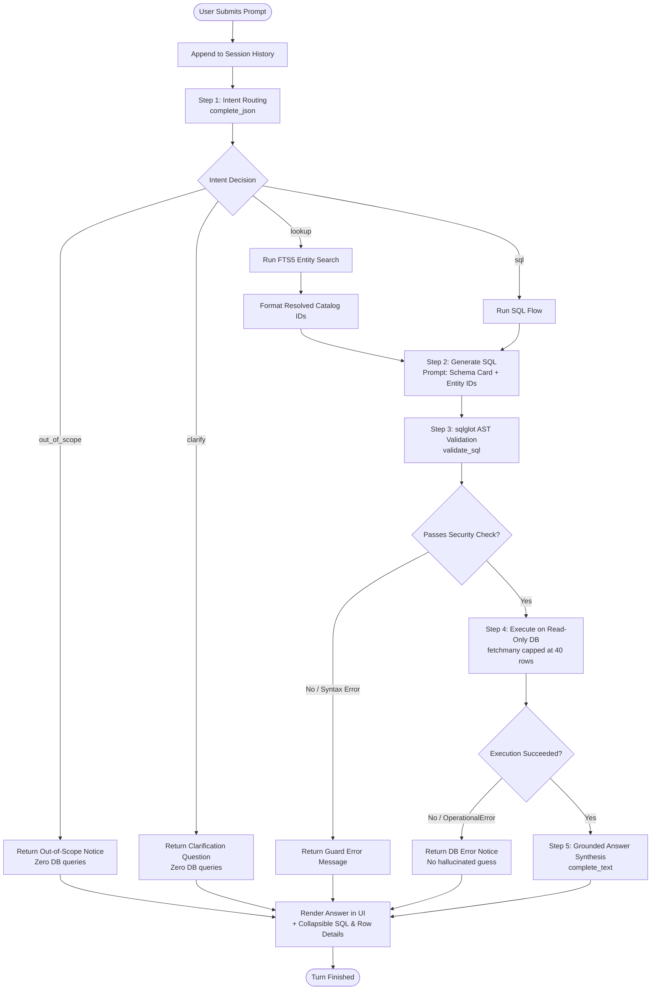
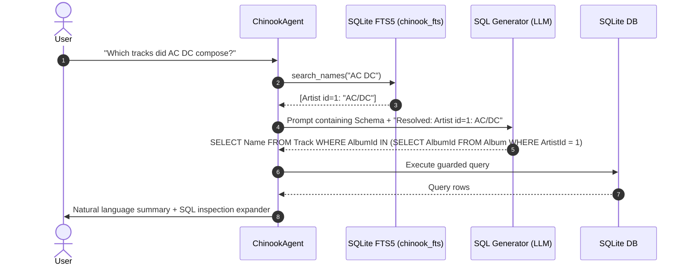
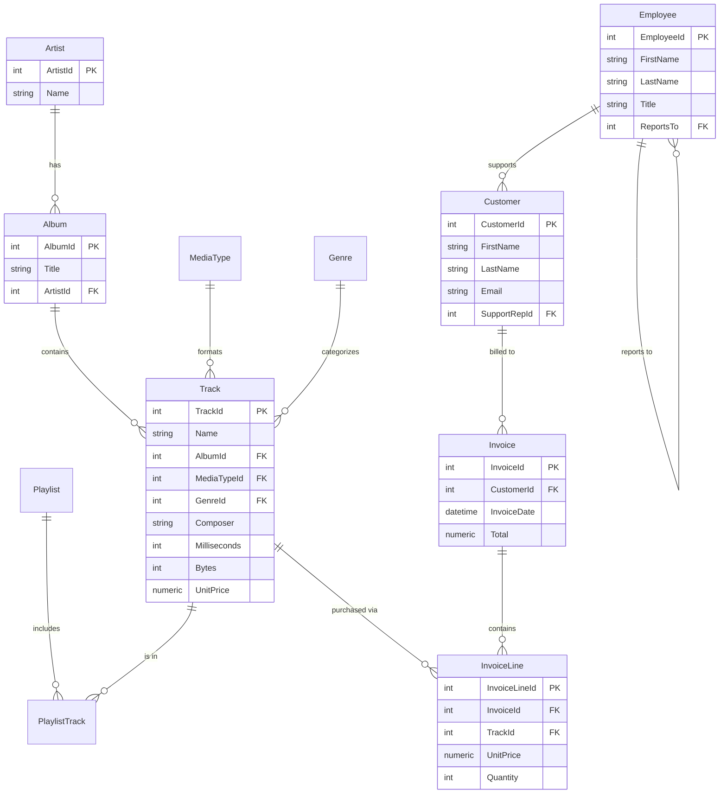

# Chinook Store Chatbot - System Architecture & Design

This document details the architectural design, security guardrails, data pipeline, and query lifecycle for the Chinook Store Chatbot.

---

## 1. High-Level System Architecture

The chatbot is structured into five decoupled layers:
1. **User Interface Layer**: Interactive Streamlit web interface with real-time feedback, execution transparency (SQL inspector, row viewer, hit inspect), and conversational session state.
2. **Agent Orchestration Layer**: Router, intent classifier, and multi-step pipeline coordinator (`ChinookAgent`).
3. **Entity Resolution Layer**: SQLite FTS5 full-text indexing engine that resolves messy user entity names (artists, tracks, albums, employees, customers) to exact database primary keys.
4. **Security & Guardrail Layer**: Abstract Syntax Tree (AST) validation via `sqlglot` and SQLite engine-level read-only constraints.
5. **Database Storage Layer**: Auto-provisioning SQLite database seeded from `Chinook_Sqlite.sql`.



---

## 2. End-to-End Query Lifecycle

Every user question passes through a deterministic, multi-stage pipeline designed to minimize hallucinations, prevent unauthorized data access, and ground answers strictly in database truth.



---

## 3. Defense-in-Depth Security Architecture

Data safety is enforced across three distinct structural tiers rather than relying solely on system prompts:

```mermaid
flowchart LR
    subgraph Tier1 ["Tier 1: AST Analysis (sqlglot)"]
        T1_1[Single Statement Check]
        T1_2[Rejection of DDL/DML Nodes]
        T1_3[Strict Table & Column Allowlist]
        T1_4[Enforced LIMIT 50 Clause]
    end

    subgraph Tier2 ["Tier 2: SQLite Connection Isolation"]
        T2_1[URI Read-Only Mode ?mode=ro]
        T2_2[PRAGMA query_only = ON]
        T2_3[Isolated Read-Only Factory]
    end

    subgraph Tier3 ["Tier 3: Prompt & Context Boundary"]
        T3_1[Schema-Card Closed World]
        T3_2[Row Result Grounding Constraint]
        T3_3[Zero External Knowledge Permitted]
    end

    Tier1 --> Tier2 --> Tier3
```



### Security Rules Enforced by `sql_guard.py`:
1. **Single Statement Only**: Multi-statement execution via `;` is strictly rejected to prevent stacked SQL injection.
2. **Forbidden AST Expressions**: Rejects AST nodes of type `Insert`, `Update`, `Delete`, `Drop`, `Create`, `Alter`, `Command`, `Merge`, `Pragma`, `Transaction`, and `Grant`.
3. **Table & Column Allowlist**: All parsed `exp.Table` and qualified `exp.Column` tokens must exist within `schema.ALLOWED_TABLES` and `schema.ALLOWED_COLUMNS`.
4. **Automatic Limit Injection**: All `SELECT` queries without an existing limit are capped at `MAX_LIMIT = 50`. Scalar aggregates (e.g. `COUNT(*)`, `SUM(Total)`) without `GROUP BY` are allowed to run without limits.

---

## 4. Entity Resolution & Linking (FTS5)

One of the most frequent failure points in Text-to-SQL systems is fuzzy entity recognition (misspellings, partial names, varying casing). The bot implements an SQLite FTS5 virtual table (`chinook_fts`) with a Porter stemmer (`tokenize = 'porter unicode61'`).



---

## 5. Data Model & Relational Topology

The Chinook database models a digital media store covering catalog inventory, store operations, employee hierarchies, and customer billing.



---

## 6. Component Directory Structure

```
chinook-chatbot/
├── app.py                 # Streamlit UI & conversation session state
├── requirements.txt       # Dependencies (streamlit, openai, sqlglot, python-dotenv)
├── README.md              # Quickstart, setup, and model configuration
├── ARCHITECTURE.md        # Architectural documentation & flowcharts (this document)
├── .env.example           # Configuration template for local Ollama, Cloud, or OpenAI
├── chinook_bot/
│   ├── __init__.py        # Exposes ChinookAgent
│   ├── agent.py           # Multi-step agent orchestrator (Router -> SQL -> Answer)
│   ├── db.py              # SQLite connection lifecycle & read-only isolation
│   ├── fts.py             # FTS5 full-text search & entity resolution
│   ├── llm.py             # Multi-provider OpenAI client & robust JSON parser
│   ├── schema.py          # Ground truth schema cards, foreign keys & business rules
│   └── sql_guard.py       # sqlglot AST parser, validator & safety clamp
├── tests/
│   └── test_offline.py    # Unit tests for DB initialization, FTS, and SQL guard
└── data/
    └── chinook.db         # Auto-generated SQLite database (git-ignored)
```

---

## 7. Trade-offs and Future Roadmap

| Capability | Current Implementation | Proposed Production Roadmap |
| :--- | :--- | :--- |
| **Error Recovery** | Static error message upon failure | **Self-Healing Reflection Loop**: Feed SQLite/guard errors back to LLM for up to 2 retry attempts. |
| **Entity Lookup** | Triggered only on `lookup` route | **Eager Entity Linking**: Extract entities via lightweight regex/FTS in parallel for all queries. |
| **Multi-turn Memory** | Retains conversational text | **Stateful Query Memory**: Retain previous SQL queries and resolved entity IDs for seamless drill-downs. |
| **Latency** | 3 sequential LLM round-trips | **Unified Tool Calling**: Merge Router and SQL Generation into a single function-calling LLM step. |

