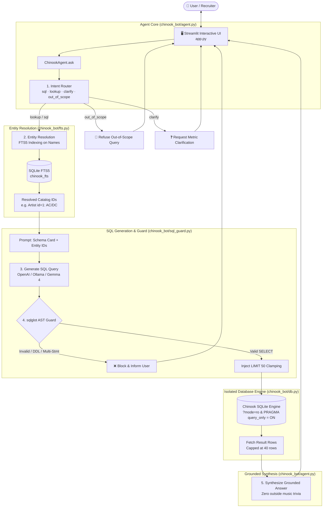

# 🎵 Chinook AI Store Assistant

> **Enterprise-Grade, Defense-in-Depth Text-to-SQL Chatbot over the Chinook SQLite Database**  
> *Architected & Built by **Supreeth Sudhakaran Menon** as an advanced technical interview challenge.*

[](https://www.python.org/)
[](https://streamlit.io/)
[](https://github.com/tobymao/sqlglot)
[](https://www.sqlite.org/fts5.html)
[](https://ollama.com/)
[](tests/test_offline.py)

---

## 💡 About The Solution & Engineering Craft

Given only a raw database dump (`Chinook_Sqlite.sql`) and the challenge to build a conversational assistant around it, this solution rejects naive text-to-SQL wrappers (which dump prompts into an unconstrained LLM and run raw SQL against production data).

Instead, this project is engineered with **production-grade rigor**, addressing the 5 fundamental failure modes of Text-to-SQL in production:

| The Real-World Failure Mode | How Most Prototypes Fail | How This Architecture Solves It |
| :--- | :--- | :--- |
| **1. Entity Misalignment** | User queries for *"AC DC"* or *"Helena"*; SQL does `WHERE Name = 'AC DC'` and returns 0 rows. | **SQLite FTS5 Full-Text Engine**: Resolves names and fuzzy misspellings into exact primary keys (`Artist id=1`) *before* SQL generation. |
| **2. SQL Injection & Destructive DDL/DML** | LLM hallucinates `DROP`, `DELETE`, `UPDATE`, or stacked `;` queries. | **AST Validation (`sqlglot`)**: Parses the Abstract Syntax Tree, strictly rejecting non-SELECT nodes, multi-statements, and non-whitelisted tables/columns. |
| **3. Accidental Write Attacks** | Malicious or buggy SQL slips past string filters. | **Database-Level Read-Only Sandbox**: Database connections enforce URI `?mode=ro` **and** execute `PRAGMA query_only = ON`. Writes are physically impossible. |
| **4. Unbounded / Expensive Queries** | User asks for *"all tracks"*; server exhausts memory trying to render 100,000 rows. | **AST-Level Limit Clamping**: Automatically injects `LIMIT 50` into the AST while intelligently sparing single-row scalar aggregations (`COUNT(*)`, `SUM()`). |
| **5. Hallucination & Trivia Bleed** | Model answers from general pre-training memory instead of store data. | **Closed-World Grounded Synthesis**: Router segregates `out_of_scope` questions; the synthesis layer answers strictly from SQL result sets. |

---

## 🏛️ System Architecture & Workflow

The architecture decouples intent routing, entity resolution, query validation, and grounded answer synthesis into a deterministic pipeline.



> 📖 **Deep Dive**: For full sequence diagrams, class models, and security threat modeling, see [ARCHITECTURE.md](ARCHITECTURE.md).

---

## 🖥️ Streamlit Dashboard & UI Walkthrough

The interface provides complete transparency into the agent's thought process and database interactions:

```
┌────────────────────────────────────────────────────────────────────────────────────────┐
│ ♪ Chinook Store Assistant                                                              │
│ Answers only from the Chinook sample database (catalog, invoices, customers, employees)│
├──────────────────────────────┬─────────────────────────────────────────────────────────┤
│ 📚 What this bot knows       │ 👤 User: Who are the top 3 customers by invoice total?  │
│                              │                                                         │
│ • Tables & Foreign Keys      │ 🤖 Assistant:                                           │
│   - Album, Artist, Customer  │ The top 3 customers by total invoice expenditure are:   │
│   - Employee, Genre, Invoice │ 1. Helena Holý ($49.62)                                 │
│   - InvoiceLine, Track, etc. │ 2. Richard Cunningham ($47.62)                          │
│                              │ 3. Luis Rojas ($46.62)                                  │
│ • Sample Questions           │                                                         │
│   - Top customers by sales   │ ▼ SQL used                                              │
│   - Tracks in Rock genre     │   ```sql                                                │
│   - AC/DC album inventory    │   SELECT c.FirstName, c.LastName, SUM(i.Total) as Spent │
│   - Support reps for clients │   FROM Customer c JOIN Invoice i ON ...                 │
│                              │   GROUP BY c.CustomerId ORDER BY Spent DESC LIMIT 3;    │
│                              │   ```                                                   │
│                              │   [Tabular Dataframe with exact row counts]             │
├──────────────────────────────┴─────────────────────────────────────────────────────────┤
│ [ Ask about Chinook artists, sales, playlists, customers...                          ] │
└────────────────────────────────────────────────────────────────────────────────────────┘
```

### Key UI Features:
1. **Interactive Conversational Flow**: Preserves chat turns and session context.
2. **SQL Transparency Expander**: Shows the exact, sanitized SQL query executed against Chinook.
3. **Live Tabular Inspector**: Displays the raw SQLite result set inside a reactive DataFrame.
4. **FTS Entity Inspector**: Displays entity matching hits and resolved IDs when catalog lookup triggers.
5. **Schema Sidebar Explorer**: Provides a breakdown of available tables, foreign key paths, and recommended queries.

*(Screenshots can be added to the [`assets/`](assets/) directory).*

---

## 🛡️ Multi-Tier Security & Guardrails

The application prevents SQL injection and unintended database mutation through three defensive walls:

1. **AST Token Inspection (`sqlglot`)**:
   - Parses incoming SQL into an Abstract Syntax Tree.
   - Forbids AST nodes: `Insert`, `Update`, `Delete`, `Drop`, `Create`, `Alter`, `Command`, `Merge`, `Pragma`, `Transaction`, `Grant`.
   - Disallows multi-statement execution (semicolon splitting).
   - Validates tables and columns against strict schema allowlists (`schema.ALLOWED_TABLES` & `schema.ALLOWED_COLUMNS`).
2. **SQLite Sandbox Isolation**:
   - Connection opened via URI read-only flag: `?mode=ro`.
   - Enforces SQLite engine pragma: `PRAGMA query_only = ON`.
3. **Memory & DOS Protection**:
   - All `SELECT` queries without explicit limits are clamped to `MAX_LIMIT = 50`.
   - Cursor fetching is capped at `fetchmany(40)`.

---

## ⚡ Setup & Installation

### 1. Prerequisites
- Python 3.10 or higher
- Git

### 2. Clone and Setup Environment

```bash
# Navigate to the chatbot directory
cd chinook-database/chinook-chatbot

# Create virtual environment
python3 -m venv .venv
source .venv/bin/activate

# Install required dependencies
pip install -r requirements.txt
```

### 3. Configure Model Provider (`.env`)

Copy the template configuration:
```bash
cp .env.example .env
```

Edit `.env` to select your preferred LLM provider:

#### Option A: Gemma 4 31B via Local Ollama (Default & Free)
```env
OPENAI_BASE_URL=http://localhost:11434/v1
OPENAI_API_KEY=ollama
OPENAI_MODEL=gemma4:31b-cloud
```

#### Option B: Gemma 4 via Ollama Cloud API
```env
OLLAMA_API_KEY=your_ollama_cloud_key
OPENAI_BASE_URL=https://ollama.com/v1
OPENAI_MODEL=gemma4:31b
```

#### Option C: OpenAI (GPT-4o / GPT-4o-mini)
```env
OPENAI_API_KEY=sk-your-openai-key-here
OPENAI_MODEL=gpt-4o-mini
OPENAI_BASE_URL=https://api.openai.com/v1
```

### 4. Run the Streamlit Application

```bash
streamlit run app.py
```

The app will:
1. Automatically load `Chinook_Sqlite.sql` into a persistent local `data/chinook.db`.
2. Construct the FTS5 virtual table (`chinook_fts`).
3. Launch the browser UI at `http://localhost:8501`.

---

## 🧪 Automated Offline Testing

A dedicated test suite validates database initialization, FTS entity resolution, and SQL AST injection blocks **without requiring an LLM API key**:

```bash
# Run offline verification
python tests/test_offline.py
```

### What is tested:
- ✅ Automatic SQLite database bootstrapping from raw SQL script.
- ✅ FTS5 full-text entity search across catalog tables.
- ✅ Rejection of `DELETE`, `DROP`, and DDL statements.
- ✅ Rejection of `sqlite_master` unauthorized schema access.
- ✅ Rejection of multi-statement semicolon injections.
- ✅ Enforcement of automatic `LIMIT 50` query caps.

---

## 📂 Project Structure

```
chinook-chatbot/
├── app.py                 # Streamlit UI & conversation session state
├── requirements.txt       # Dependencies (streamlit, openai, sqlglot, python-dotenv)
├── README.md              # Project showcase & setup guide (this file)
├── ARCHITECTURE.md        # Technical architecture, sequence diagrams & ER schema
├── .env.example           # Template for LLM configurations
├── assets/                # Screenshots and visual UI assets
├── chinook_bot/
│   ├── __init__.py        # Exports ChinookAgent
│   ├── agent.py           # Multi-step Agent Orchestrator (Intent -> FTS -> SQL -> Answer)
│   ├── db.py              # Database initialization & Read-Only isolation (?mode=ro)
│   ├── fts.py             # SQLite FTS5 index & Entity Resolver
│   ├── llm.py             # Provider-agnostic client + JSON markdown fence stripper
│   ├── schema.py          # Ground truth schema cards, foreign keys & revenue logic
│   └── sql_guard.py       # sqlglot AST security analyzer & LIMIT enforcer
├── tests/
│   └── test_offline.py    # Offline test suite (DB, FTS, and Security validation)
└── data/
    └── chinook.db         # Auto-generated SQLite database (git-ignored)
```

---

## 👨‍💻 Author

**Supreeth Sudhakaran Menon**  
- **GitHub**: [@SupreethSudhakaranMenon](https://github.com/SupreethSudhakaranMenon)
- **Role**: Software & AI Engineer
- **Project Context**: Built as an intelligent conversational database wrapper demonstration.
